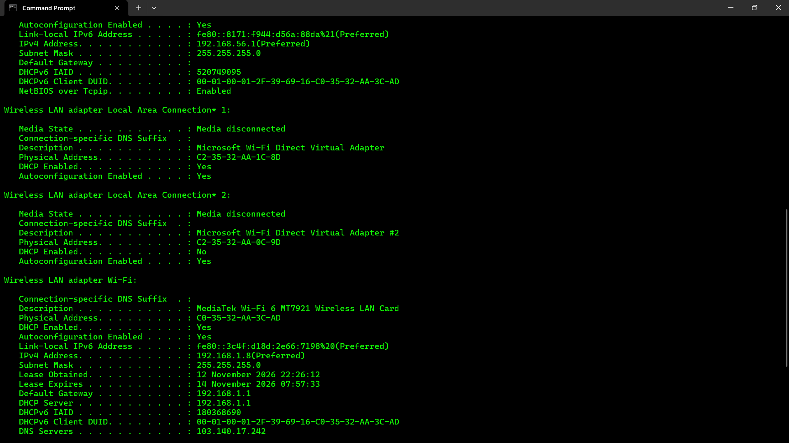

# Week 2 – Penetration Testing & Network Reconnaissance Report

**Modules covered**
- **W2-PM1 – Footprinting with Six Kali Tools (Elective) — Elective module**
- **W2-PM5 – Zenmap-Based Network Scanning (Essential) — Essential module**

**Prepared by:** Nevin K Jolly  
**Date:** 13 November 2026  
**Platform:** Kali Linux running in Oracle VirtualBox

---

## Table of Contents

1. [Executive Summary](#1-executive-summary)
2. [Objectives](#2-objectives)
3. [Scope, Environment and Methodology](#3-scope-environment-and-methodology)
4. [W2-PM1 – Footprinting with Six Kali Tools (Elective)](#4-w2-pm1--footprinting-with-six-kali-tools-elective)
   - [4.1 WHOIS](#41-whois--domain-registration-lookup)
   - [4.2 WhatWeb](#42-whatweb--website-technology-fingerprinting)
   - [4.3 nslookup](#43-nslookup--dns-resolution)
   - [4.4 curl -I](#44-curl--i--http-response-header-inspection)
   - [4.5 WAFW00F](#45-wafw00f--web-application-firewall-fingerprinting)
   - [4.6 DNSRecon](#46-dnsrecon--dns-record-enumeration)
5. [W2-PM5 – Zenmap-Based Network Scanning (Essential)](#5-w2-pm5--zenmap-based-network-scanning-essential)
6. [Supplementary Activity – Traceroute](#6-supplementary-activity--traceroute)
7. [Consolidated Findings](#7-consolidated-findings)
8. [Security Observations and Recommendations](#8-security-observations-and-recommendations)
9. [Limitations](#9-limitations)
10. [Conclusion](#10-conclusion)
11. [Appendix A – Commands Used](#appendix-a--commands-used)
12. [Appendix B – Evidence Register](#appendix-b--evidence-register)

---

## 1. Executive Summary

This report documents two completed Week 2 project modules: **W2-PM1**, the elective module on footprinting with six Kali Linux tools, and **W2-PM5**, the essential module on Zenmap-based network scanning. The exercises used `networkwalks.com` as the website footprinting target and the local lab subnet `192.168.1.0/24` for host discovery.

The footprinting work used WHOIS, WhatWeb, nslookup, `curl -I`, WAFW00F and DNSRecon. The results identified domain-registration information, the resolved web-server IP address, visible web technologies, HTTP response headers, a ModSecurity (SpiderLabs) web application firewall fingerprint, and DNS records including A, NS, MX, TXT and SRV records.

The Zenmap ping scan discovered six responsive hosts in the `192.168.1.0/24` subnet. The scan covered 256 IP addresses and completed in approximately 8.59 seconds. Because the selected Zenmap profile was **Ping scan** (`nmap -sn`), this was host discovery only; it did not determine which TCP/UDP ports or services were open.

An additional traceroute exercise was performed and is included as supplementary activity. It is not counted among the six required W2-PM1 tools.

## 2. Objectives

- Perform domain and website footprinting using six Kali Linux tools.
- Collect publicly observable registration, DNS, HTTP and web-technology information.
- Identify the target website's apparent web application firewall using WAFW00F.
- Enumerate DNS records using DNSRecon.
- Discover active devices on the local lab subnet using Zenmap/Nmap.
- Interpret the findings, identify limitations and document the results with evidence.

## 3. Scope, Environment and Methodology

| Item | Details |
|---|---|
| W2-PM1 target | `https://networkwalks.com/` |
| Domain | `networkwalks.com` |
| Resolved address observed | `192.232.216.135` |
| W2-PM5 target | `192.168.1.0/24` (local lab subnet) |
| Platform | Kali Linux in Oracle VirtualBox |
| Zenmap / Nmap | Nmap 7.98 |
| WhatWeb | 0.6.4 |
| WAFW00F | 2.4.2 |
| DNSRecon | 1.6.0 |

The public website footprinting exercise and the local subnet scan are separate activities. The local subnet scan was performed from the Kali Linux virtual machine using Zenmap.

**Methodology:**

1. Collect domain-registration data with WHOIS.
2. Fingerprint the website with WhatWeb.
3. Resolve the domain with nslookup.
4. Inspect HTTP response headers with `curl -I`.
5. Fingerprint the WAF with WAFW00F.
6. Enumerate DNS records with DNSRecon.
7. Perform a Zenmap ping scan of the local subnet.

The commands and target values are listed in [Appendix A](#appendix-a--commands-used).

## 4. W2-PM1 – Footprinting with Six Kali Tools (Elective)

This elective module uses six tools to collect publicly observable information about the target domain and website.

### 4.1 WHOIS – Domain Registration Lookup

**Command:**

```bash
whois networkwalks.com
```

**Purpose:** WHOIS queries the domain-registration database and returns registrar, registration dates, domain status, name-server and registrant-contact information where publicly available.

**Observed results:**

- Domain name: `NETWORKWALKS.COM`
- Registrar: GoDaddy.com, LLC
- Creation date: 2019-11-06
- Registry/registrar expiry date shown: 2027-11-06
- Updated date shown in the captured output: 2025-11-12
- Registrar WHOIS server: `whois.godaddy.com`
- Registrar URL: `https://www.godaddy.com`
- Registrant and technical contact details were privacy-protected through Domains By Proxy, LLC.
- Nameservers included `NS6135.HOSTGATOR.COM` and `NS6136.HOSTGATOR.COM`; a later WHOIS response also listed `NS29.DOMAINCONTROL.COM` and `NS30.DOMAINCONTROL.COM`.
- DNSSEC was reported as unsigned.

**Interpretation:** The domain is registered through GoDaddy and uses name-server infrastructure associated with HostGator and DomainControl. Registrant privacy protection limits the personal information exposed by the WHOIS record. The displayed expiry date is the registry/registrar record date and may not necessarily be the final customer-facing renewal date.

**Evidence – WHOIS registration details**



**Evidence – WHOIS contact privacy and nameservers**


### 4.2 WhatWeb – Website Technology Fingerprinting

**Command:**

```bash
whatweb -v https://networkwalks.com/
```

**Purpose:** WhatWeb inspects website responses and page content to identify technologies, content-management systems, libraries, cookies and server indicators.

**Observed results:**

- HTTP status: `200 OK`
- Page title: `Networkwalks Academy`
- IP address: `192.232.216.135`
- Server identified: Apache
- WordPress detected: version `7.1.4`
- WordPress Download Manager: `3.3.76`
- jQuery: `3.7.1`
- Google Tag Manager detected
- HTML5 and Open Graph metadata detected
- Frames/iframes detected
- Cookie `__wpdm_client` detected with the HttpOnly attribute
- WhatWeb also displayed `Bootstrap[7.1.4]`. This is recorded as reported by the tool and should be independently verified before being treated as a confirmed framework version.

**Interpretation:** The site appears to use WordPress and the WordPress Download Manager plugin, with Apache identified in the HTTP server header. This technology fingerprint can help with asset inventory and prioritising version verification. It does not, by itself, prove that any component is vulnerable.

**Evidence – WhatWeb fingerprint**


### 4.3 nslookup – DNS Resolution

**Command:**

```bash
nslookup networkwalks.com
```

**Purpose:** nslookup asks a DNS resolver to return DNS information for a hostname.

**Observed results:**

- Resolver: `8.8.8.8` (Google Public DNS)
- Domain: `networkwalks.com`
- Returned IPv4 address: `192.232.216.135`

**Interpretation:** The domain resolved successfully to `192.232.216.135` at the time of testing. DNS answers can change due to hosting, CDN, load-balancing or DNS configuration changes, so this result is time-specific.

**Evidence – nslookup output**


### 4.4 curl -I – HTTP Response Header Inspection

**Command:**

```bash
curl -I https://networkwalks.com
```

**Purpose:** The `-I` option requests the response headers without downloading the complete page body. It helps identify server responses, cookies, content type and security-related header configuration.

**Observed results from the captured terminal output:**

- HTTP response: `HTTP/1.1 200 OK`
- Date header: `Fri, 13 Nov 2026 14:00:23 GMT`
- Server: `Apache`
- Content-Type: `text/html; charset=UTF-8`
- `Set-Cookie` for `__wpdm_client` with `Secure` and `HttpOnly` attributes
- `Referrer-Policy: no-referrer-when-downgrade`
- `Permissions-Policy` header present
- WordPress-related `Link` headers exposed the REST API relation and page endpoint
- `X-Endurance-Cache-Level` and `X-nginx-cache: WordPress` headers were also present

**Interpretation:** The server returned a successful response and exposed several implementation details in its headers. The observed cookie has Secure and HttpOnly attributes, which are useful protections for that cookie. The presence of a security header does not establish that its policy is optimal; the actual directives and application context would need review.

**Evidence – HTTP response headers**


### 4.5 WAFW00F – Web Application Firewall Fingerprinting

**Command:**

```bash
wafw00f https://networkwalks.com
```

**Purpose:** WAFW00F sends a small set of HTTP requests and compares responses with known WAF fingerprints to identify a possible web application firewall.

**Observed results:**

- WAFW00F version: `2.4.2`
- The tool reported that `https://networkwalks.com` is behind **ModSecurity (SpiderLabs) WAF**.
- Number of requests: `2`

**Interpretation:** The response pattern matched the ModSecurity (SpiderLabs) fingerprint in WAFW00F's detection database. This is a fingerprinting result, not a full validation of the WAF's rules, coverage or effectiveness. A WAF may also be configured in detection-only or blocking mode; this test did not establish which mode is active.

**Evidence – WAFW00F result**


### 4.6 DNSRecon – DNS Record Enumeration

**Command:**

```bash
dnsrecon -d networkwalks.com
```

**Purpose:** DNSRecon queries DNS records and performs standard enumeration checks to identify infrastructure and mail/service configuration.

**Observed results:**

DNSRecon 1.6.0 completed general enumeration and reported **8 records**. The output included:

- SOA information for `ns6135.hostgator.com`
- NS records: `ns6135.hostgator.com` and `ns6136.hostgator.com`
- A record: `networkwalks.com` → `192.232.216.135`
- MX record: `networkwalks.com` → `192.232.216.135`
- TXT SPF record beginning `v=spf1 +a +mx +ip4:50.87.144.87 +include:websitewelcome.com ~all`
- A Google site-verification TXT value
- SRV records for `_autodiscover._tcp.networkwalks.com` pointing to `cpanelemaildiscovery.cpanel.net` on port `443`
- Multiple SRV responses with associated addresses
- The tool logged `No answer for DNSSEC query` for the DNSSEC check

**Interpretation:** The DNS data indicates web and mail-related records and exposes service-discovery information associated with the hosting environment. The SPF record authorises the mechanisms listed in that record for sending mail. The DNSSEC message means the query did not return an answer in this run; it should not be interpreted as a complete DNSSEC audit without checking the authoritative zone and parent delegation.

**Evidence – DNSRecon output**


## 5. W2-PM5 – Zenmap-Based Network Scanning (Essential)

This is the **essential network-scanning module**. It is separate from the W2-PM1 website footprinting elective.

### 5.1 Scan Configuration

| Setting | Value |
|---|---|
| Application | Zenmap (Nmap 7.98) |
| Target | `192.168.1.0/24` |
| Profile | Ping scan |
| Generated command | `nmap -sn 192.168.1.0/24` |

**Purpose:** A ping scan performs host discovery to determine which IP addresses respond. The `-sn` option disables the port-scan stage. It is appropriate for identifying active hosts on a local network before any separately authorised service enumeration.

### 5.2 Results

Zenmap reported **256 IP addresses scanned** and **6 hosts up** in approximately **8.59 seconds**.

| Active host | MAC address | Vendor shown in Zenmap |
|---|---|---|
| `192.168.1.1` | `14:A7:2B:31:19:CA` | currentoptronics Pvt. Ltd. |
| `192.168.1.3` | `B8:AB:62:A5:90:CE` | Hui Zhou Gaoshengda Technology |
| `192.168.1.5` | `3C:B0:ED:73:E3:0C` | Nothing Technology Limited |
| `192.168.1.7` | `02:A3:11:EB:BF:F8` | Unknown |
| `192.168.1.8` | Not visible in supplied output | Not available |
| `192.168.1.10` | `4A:76:0D:9B:7D:1A` | Unknown |

### 5.3 Interpretation

The scan confirms that six devices responded to host discovery within the selected `/24` subnet at the time of the scan. The address `192.168.1.1` is commonly used as a gateway address, but the screenshot alone does not confirm the device's role. MAC vendor identification is based on the address prefix and may be absent, inaccurate or obscured by virtualisation, randomised MAC addresses or network boundaries.

**Important limitation:** Because the selected profile was Ping scan (`nmap -sn`), the output does not show open, closed or filtered ports and does not identify running services or operating systems. A separate, explicitly authorised port/service scan would be required for those results.

**Evidence – Zenmap ping scan**


**Evidence – network topology diagram**


## 6. Supplementary Activity – Traceroute

Traceroute is included as supplementary activity and is **not counted among the six W2-PM1 tools**.

**Commands shown:**

```bash
traceroute -I networkwalks.com
sudo traceroute -T -p 443 networkwalks.com
```

**Observed results:**

- The destination resolved to `192.232.216.135`.
- The ICMP-based trace showed the first hop as `10.0.2.2`.
- Several intermediate hops did not return probe responses and were displayed as `* * *`.
- The destination appeared at hop 15 as `192-232-216-135.unifiedlayer.com` (`192.232.216.135`), with round-trip measurements around 282–283 ms in the displayed run.
- The TCP trace to destination port 443 reached the destination in one reported hop, with measurements around 264–270 ms.

**Interpretation:** The first hop `10.0.2.2` is consistent with a virtual/NAT gateway in the lab environment. Asterisks indicate that probes did not receive a response before the timeout; they do not prove that routers are offline. Firewalls and router policies commonly suppress traceroute responses.

**Evidence – traceroute output**


## 7. Consolidated Findings

| Area | Finding |
|---|---|
| Domain registration | GoDaddy.com, LLC; creation date 2019-11-06; expiry date shown as 2027-11-06; registrant privacy protection enabled; DNSSEC reported unsigned in WHOIS. |
| DNS resolution | `networkwalks.com` resolved to `192.232.216.135` using resolver `8.8.8.8`. |
| Web technologies | Apache and WordPress detected; WordPress Download Manager 3.3.76 and jQuery 3.7.1 also reported. |
| HTTP response | `200 OK`; Apache server header; `__wpdm_client` cookie included Secure and HttpOnly; WordPress-related response links were exposed. |
| WAF fingerprint | WAFW00F identified ModSecurity (SpiderLabs), based on two requests. |
| DNS enumeration | 8 records reported, including A, NS, MX, TXT and SRV data. |
| Local network discovery | 6 active hosts found in `192.168.1.0/24` out of 256 scanned addresses. |
| Traceroute | Destination reached; intermediate routers did not respond to every probe. |

## 8. Security Observations and Recommendations

1. **Verify and maintain software versions.** Confirm the actual WordPress core, WordPress Download Manager and JavaScript library versions from the server/application inventory, then apply supported security updates.
2. **Review exposed metadata.** Consider whether WordPress REST API discovery links, generator metadata and other response details need to be publicly exposed. Do not disable required functionality without testing.
3. **Review HTTP security headers.** Validate the exact Content-Security-Policy, Strict-Transport-Security, X-Content-Type-Options, Referrer-Policy and Permissions-Policy configuration. The captured output did not establish that all recommended headers are present.
4. **Review cookie settings.** The observed `__wpdm_client` cookie had Secure and HttpOnly attributes. Confirm whether SameSite is appropriate and whether all session/authentication cookies use suitable flags.
5. **Review DNS configuration.** Confirm that DNSSEC is intentionally configured or document why it is not used. Review SPF, DKIM and DMARC together; the exercise only captured an SPF TXT record and did not test mail authentication end-to-end.
6. **Review WAF operation.** Confirm that ModSecurity is enabled, maintained and operating with appropriate rules in blocking mode where suitable. WAFW00F fingerprinting alone cannot verify rule quality or effectiveness.
7. **Protect internal network assets.** Maintain an inventory of the six discovered hosts, identify unknown devices, and ensure router, endpoint and IoT firmware are updated. Restrict management interfaces to trusted networks.
8. **Perform further testing only with written authorisation.** Any port scan, vulnerability scan, exploitation attempt or authenticated testing should be separately scoped and approved.

## 9. Limitations

- The findings are a point-in-time record from the supplied screenshots and terminal output. DNS records, IP addresses, software versions and response headers can change.
- WhatWeb and WAFW00F rely on detectable response patterns; their results may be incomplete or inaccurate. A detected technology does not automatically indicate a vulnerability.
- The DNSRecon DNSSEC message is not a full DNSSEC validation. No DKIM or DMARC verification was supplied.
- The Zenmap exercise used host discovery only. No port-state, service-version or operating-system results were collected.
- The supplied screenshots do not include a separate screenshot for every command (notably nslookup and `curl -I`); their outputs are documented from the terminal results shared for the practical.

## 10. Conclusion

The Week 2 elective **W2-PM1** was completed using six Kali Linux footprinting tools: WHOIS, WhatWeb, nslookup, `curl -I`, WAFW00F and DNSRecon. The exercise gathered domain-registration details, DNS information, web-technology indicators, HTTP headers and a WAF fingerprint for `networkwalks.com`.

The essential **W2-PM5** was completed using Zenmap's Ping scan profile against `192.168.1.0/24`. Six responsive hosts were discovered from 256 scanned addresses. The scan provided a useful view of active devices but did not inspect ports or services because it used `nmap -sn`.

Together, the modules demonstrate how reconnaissance and host discovery support the early stages of a security assessment. All results should be treated as observations rather than proof of vulnerabilities, and any further testing should remain within a clearly authorised scope.

## Appendix A – Commands Used

### W2-PM1 – Footprinting with Six Kali Tools

```bash
whois networkwalks.com
whatweb -v https://networkwalks.com/
nslookup networkwalks.com
curl -I https://networkwalks.com
wafw00f https://networkwalks.com
dnsrecon -d networkwalks.com
```

### W2-PM5 – Zenmap-Based Network Scanning

- **Zenmap target:** `192.168.1.0/24`
- **Zenmap profile:** Ping scan
- **Generated command:**

```bash
nmap -sn 192.168.1.0/24
```

### Supplementary Traceroute

```bash
traceroute -I networkwalks.com
sudo traceroute -T -p 443 networkwalks.com
```

## Appendix B – Evidence Register

| Figure | Evidence |
|---|---|
| 1 | WHOIS domain registration output – `screenshots/whois-registration.png` |
| 2 | WHOIS contact privacy and nameserver output – `screenshots/whois-contact-nameservers.png` |
| 3 | WhatWeb website technology fingerprint – `screenshots/whatweb-fingerprint.png` |
| 4 | WAFW00F output identifying ModSecurity (SpiderLabs) – `screenshots/wafw00f-detection.png` |
| 5 | DNSRecon enumeration output – `screenshots/dnsrecon-enumeration.png` |
| 6 | Zenmap ping scan showing six active hosts – `screenshots/zenmap-ping-scan.png` |
| 7 | Network topology diagram – `screenshots/network-topology.png` |
| 8 | Supplementary ICMP and TCP traceroute output – `screenshots/traceroute-output.png` |

---

**Disclaimer:** This report is for educational purposes. Testing should only be performed on systems and networks for which permission has been obtained.
